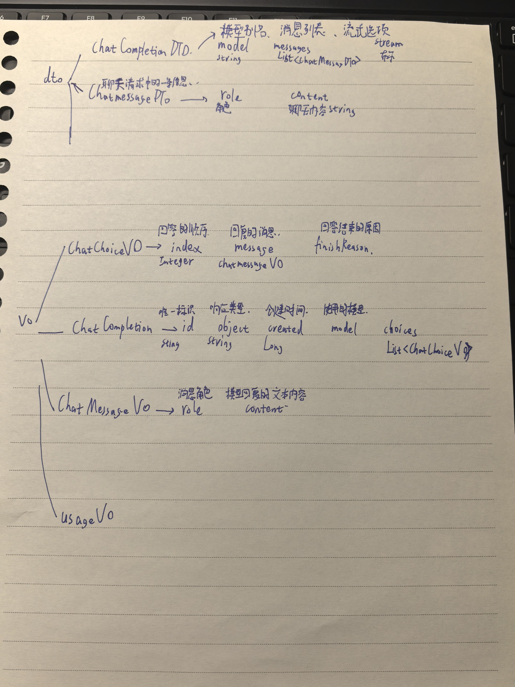

# 01

今天是我第一次对于这个项目进行一个总结，说实话确实没什么经验，虽然暑假学过了后端，但是面对中转站这个项目也没什么头绪，就跟着ai 去做，让AI指导我一下这些都是什么，以下是我的心得与总结，纯手敲，为了工作留痕。

首先，通过这个项目，我得知了中转站需要传入的数据和需要传出的数据，以及中转站的大致工作原理。中转站就是通过API秘钥与大模型实现沟通的平台，用户在输入需要调用的大模型和需要回答的问题后，中转站会去调用这些模型并且把AI生成的回答通过流式的方式发送给用户，目前只有很基础的测试功能，发送固定的请求内容以检验我写的controller，DTO，VO能不能跑通，下一步我将会把这个固定的请求换成deepseek的真实的回答。然后下面这个是我画的程序的框架吧，我会更好理解一点，字太差了，还请不用看，只是为了工作留痕

