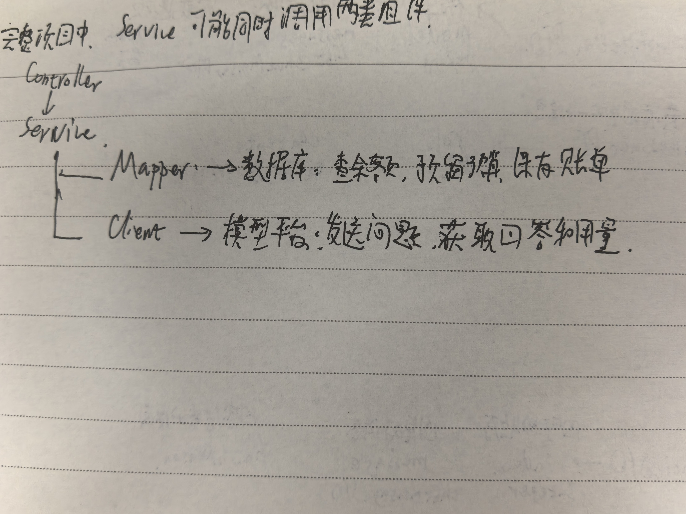
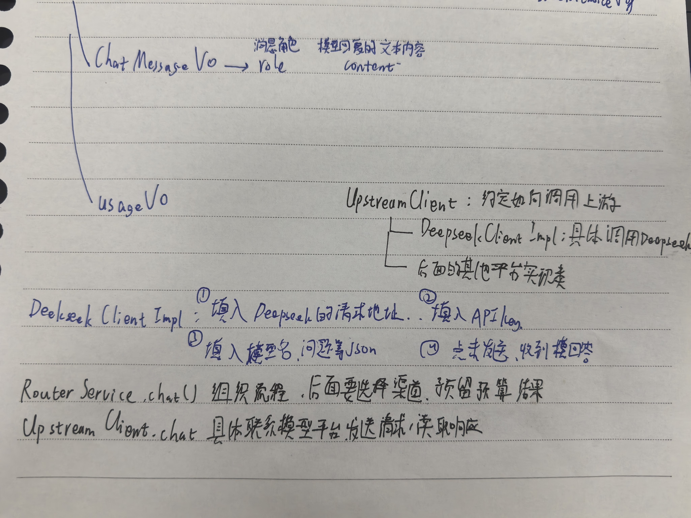

实现deepseek的非流式聊天

重大发现，我终于知道那些莫名其妙就出现在DTO和VO的属性都来自哪里了，我找到了[**DeepSeek API 文档**](https://api-docs.deepseek.com/zh-cn/) ，里面的数据间的包含关系非常明确。

这次有两个新的名字里面带client的东西，这个跟service还挺像的，但是要负责的具体事物不一样，UpStreamClient.chat是负责联系模型平台，发送请求，读取相应，RouterService.chat是负责组织流程，在后面要选择渠道，预留预算结果的。然后mapper和client又不一样，mapper是用来读取数据库里面的东西的，而client是用来读取其他平台的服务的，比如像deepseek。要查自己的数据就查mapper。要请求别人的接口，就找client。

然后是把deepseek的地址，key和模型名放进配置，再用一个类接住它们。

然后去deepseekClientImpl里面把要传输的内容和要接收的内容搞出来，中间用到了private final RestClient restClient = RestClient.create()这个，它是HTTP客户端，用于发送HTTP请求。

工作留痕

